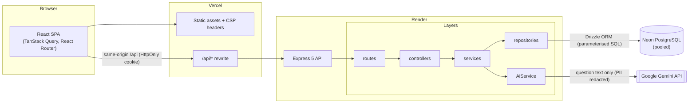
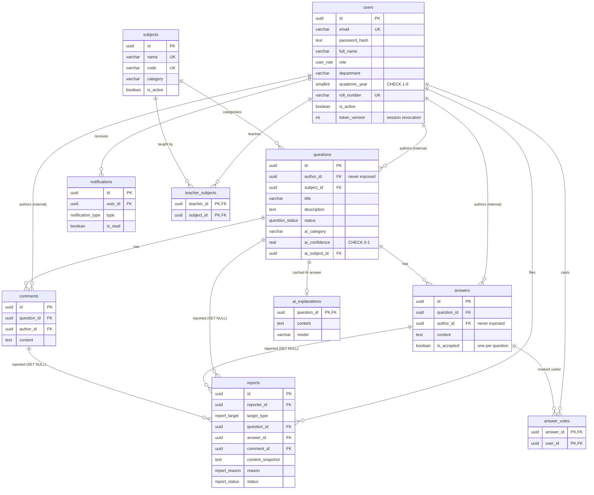
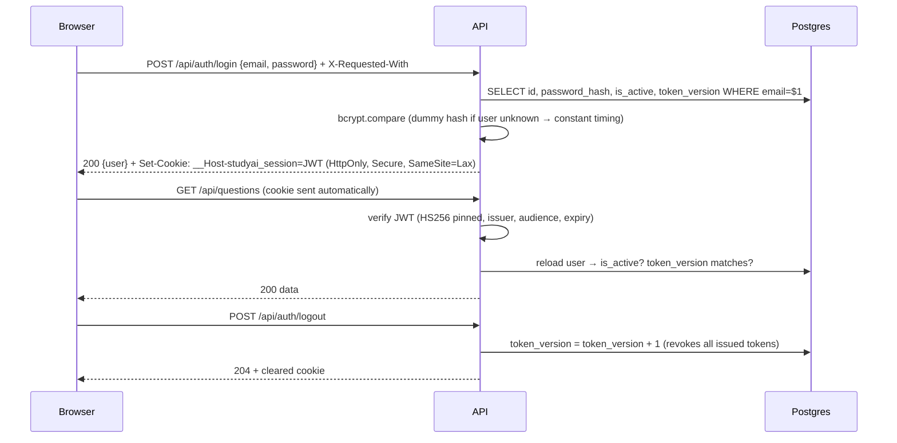

# StudyAI – Anonymous Academic Doubt-Solving Platform

StudyAI lets college students ask academic questions **anonymously** and get answers from teachers, classmates and an
AI assistant. Classmates never see who asked; the platform still keeps an internal, access-controlled link between a
question and its author so accounts can be managed and abuse can be moderated.

> React · TypeScript · Express 5 · PostgreSQL (Neon) · Drizzle ORM · Google Gemini · Vitest

---

## Contents

1. [Problem statement](#1-problem-statement)
2. [Features](#2-features)
3. [Architecture](#3-architecture)
4. [Technology stack](#4-technology-stack)
5. [Database schema](#5-database-schema)
6. [API overview](#6-api-overview)
7. [Authentication flow](#7-authentication-flow)
8. [Anonymous question architecture](#8-anonymous-question-architecture)
9. [AI integration](#9-ai-integration)
10. [Privacy & security decisions](#10-privacy--security-decisions)
11. [Local installation](#11-local-installation)
12. [Environment configuration](#12-environment-configuration)
13. [Database migrations](#13-database-migrations)
14. [Testing](#14-testing)
15. [Deployment](#15-deployment)
16. [Technical decisions & trade-offs](#16-technical-decisions--trade-offs)
17. [Future improvements](#17-future-improvements)

Further docs: [API reference](docs/API.md) · [Deployment guide](docs/DEPLOYMENT.md) · [Privacy model](docs/PRIVACY.md) ·
[Backend README](backend/README.md) · [Frontend README](frontend/README.md)

---

## 1. Problem statement

Many students don't ask questions in class because they fear being judged by classmates or teachers. Small gaps in
understanding compound. StudyAI removes the social cost of asking: a student posts a doubt, classmates and teachers
see only _“Anonymous student”_, and answers arrive from teachers (clearly badged), classmates and – clearly labelled –
AI.

## 2. Features

| Role        | Capabilities                                                                                                                                                                                                                                                                              |
| ----------- | ----------------------------------------------------------------------------------------------------------------------------------------------------------------------------------------------------------------------------------------------------------------------------------------- |
| **Student** | Register/login · ask anonymous questions · AI subject suggestion · personal-information warning before posting · browse/search/filter · answer & comment · accept an answer · mark answers useful · report content · AI explanations & free-form AI assistant · notifications · dashboard |
| **Teacher** | Provisioned by an admin · dashboard for assigned subjects · unanswered queue · answer (shown with name + Teacher badge) · “my answers” management · statistics                                                                                                                            |
| **Admin**   | User management (provision teachers/admins, change roles, suspend) · subject catalogue · moderation queue · reports (resolve/dismiss, remove content) · suspend an anonymous author _without seeing who it is_ · platform analytics                                                       |

Cross-cutting: role-based access control, rate limiting, CSRF protection, HttpOnly cookie sessions with server-side
revocation, full-text search, pagination, responsive UI with dark mode, loading skeletons, empty states and toasts.

## 3. Architecture



**Backend layering** (`backend/src`):

| Layer           | Responsibility                                                            |
| --------------- | ------------------------------------------------------------------------- |
| `routes/`       | Path → middleware (auth, role, rate limit) → controller. No logic.        |
| `controllers/`  | Parse & validate input with Zod, call a service, shape the HTTP response. |
| `services/`     | Business rules, permissions, transactions, notifications.                 |
| `repositories/` | Privacy-critical SQL with explicit column allow-lists.                    |
| `serializers/`  | Whitelisted response DTOs – raw rows are never returned.                  |
| `middleware/`   | Authentication, roles, CSRF, rate limiting, central error handling.       |
| `validators/`   | Zod request schemas (strict objects – unknown keys rejected).             |
| `services/ai/`  | Provider interface, Gemini implementation, PII detector, prompts.         |

`createApp({ config, db, aiProvider })` receives its dependencies, so the test-suite injects an in-process PostgreSQL
(PGlite) and a mock AI provider – no network, no paid API calls.

## 4. Technology stack

| Area       | Choice                                                                                                                                                    |
| ---------- | --------------------------------------------------------------------------------------------------------------------------------------------------------- |
| Frontend   | React 19, Vite 8, TypeScript, Tailwind CSS 4, shadcn/ui (Radix), React Router 7, TanStack Query 5, Axios, react-hook-form + Zod, Recharts, Lucide, Sonner |
| Backend    | Node.js, Express 5, TypeScript, Zod 4, jsonwebtoken, bcrypt (bcryptjs), helmet, cors, express-rate-limit, pino                                            |
| Database   | PostgreSQL on Neon, Drizzle ORM, Drizzle Kit migrations                                                                                                   |
| AI         | Google Gemini via the official `@google/genai` SDK                                                                                                        |
| Testing    | Vitest, Supertest, PGlite (real Postgres in WASM), Testing Library                                                                                        |
| Deployment | Vercel (frontend), Render (API), Neon (DB), GitHub Actions (CI)                                                                                           |

## 5. Database schema



Notable constraints: UUID PKs everywhere, `created_at`/`updated_at` timestamps, unique email/roll number, a partial
unique index allowing **one accepted answer per question**, per-target partial unique indexes so a user reports content
only once, a CHECK that a report's target column matches its type, and a GIN full-text index on
`title || description`. `refresh_tokens` is intentionally absent – see [§16](#16-technical-decisions--trade-offs).

## 6. API overview

All endpoints are under `/api`. Errors are always `{ "error": { "code", "message", "details?" } }`. Full reference:
[docs/API.md](docs/API.md).

| Area          | Endpoints                                                                                                                                                                                                                               |
| ------------- | --------------------------------------------------------------------------------------------------------------------------------------------------------------------------------------------------------------------------------------- |
| Auth          | `POST /auth/register` · `POST /auth/login` · `POST /auth/logout` · `GET /auth/me`                                                                                                                                                       |
| Me            | `PATCH /users/me` · `PATCH /users/me/password` · `GET /users/me/statistics`                                                                                                                                                             |
| Questions     | `GET/POST /questions` · `GET/PATCH/DELETE /questions/:id`                                                                                                                                                                               |
| Answers       | `GET/POST /questions/:id/answers` · `PATCH/DELETE /answers/:id` · `POST /answers/:id/accept` · `PUT/DELETE /answers/:id/useful`                                                                                                         |
| Comments      | `GET/POST /questions/:id/comments` · `DELETE /comments/:id`                                                                                                                                                                             |
| Subjects      | `GET /subjects` · `POST /subjects` · `PATCH /subjects/:id`                                                                                                                                                                              |
| AI            | `GET /ai/status` · `POST /ai/classify-question` · `POST /ai/check-personal-information` · `POST /ai/ask`                                                                                                                                |
| Notifications | `GET /notifications` · `GET /notifications/unread-count` · `PATCH /notifications/:id/read` · `PATCH /notifications/read-all`                                                                                                            |
| Reports       | `POST /reports`                                                                                                                                                                                                                         |
| Teacher       | `GET /teacher/questions` · `GET /teacher/answers` · `GET /teacher/subjects` · `GET /teacher/statistics`                                                                                                                                 |
| Admin         | `GET/POST /admin/users` · `GET/PATCH /admin/users/:id` · `PUT /admin/users/:id/subjects` · `GET /admin/statistics` · `GET /admin/questions` · `PATCH /admin/questions/:id/moderate` · `GET /admin/reports` · `PATCH /admin/reports/:id` |
| Health        | `GET /health`                                                                                                                                                                                                                           |

## 7. Authentication flow



- Passwords: bcrypt (cost 12), 10–72 chars with upper/lower/digit/symbol, may not contain the email name.
- Registration always creates a **STUDENT**; the request schema is strict, so `role`, `isActive`, … are rejected.
  Teachers/admins are provisioned via `POST /api/admin/users`; the first admin via `npm run create-admin`.
- The JWT is never readable by JavaScript. The user is reloaded on each request, so suspensions, role changes,
  password changes and logouts take effect immediately.

## 8. Anonymous question architecture

Anonymity is enforced in **three independent layers**, never by hiding fields in the UI:

1. **Repository projections** (`repositories/question.repository.ts`, `answer.repository.ts`): public queries select
   an explicit column list that omits `author_id`. Ownership is exposed only as `isOwn`, a boolean computed in SQL
   _against the requesting user_. For answers/comments, the author's name is selected via
   `CASE WHEN role = 'TEACHER' THEN full_name END` – a student's name never leaves the database.
2. **Serializers / DTOs** (`serializers/index.ts`): every response is built from a whitelist; DB rows are never
   returned.
3. **Automated privacy tests** (`tests/integration/privacy.test.ts`): deep-scan real responses for forbidden keys
   (`authorId`, `email`, `passwordHash`, …) and for the author's actual id, email, name, roll number and bcrypt hash.
   We verified the suite fails when a leak is deliberately injected.

Example public question:

```json
{
  "id": "0b4c…",
  "title": "How does normalization work in DBMS?",
  "description": "Can someone explain 2NF and 3NF?",
  "subject": { "id": "91fe…", "name": "Database Management Systems", "code": "CS202" },
  "category": "Normalization",
  "status": "OPEN",
  "answerCount": 1,
  "commentCount": 0,
  "hasTeacherAnswer": true,
  "hasAcceptedAnswer": false,
  "isOwn": false,
  "createdAt": "2026-11-10T10:00:00.000Z",
  "updatedAt": "2026-11-10T10:00:00.000Z"
}
```

Even **admins** never see question authors through the API. Moderation acts on content; `suspendAuthor: true` lets an
admin suspend the author's account server-side without learning who it is. Limitations are documented honestly in
[docs/PRIVACY.md](docs/PRIVACY.md).

## 9. AI integration

All AI calls go through `AiService` → `AiProvider` interface → `GeminiProvider` (official `@google/genai` SDK). The
API key lives only on the server.

| Feature                             | How it works                                                                                                                                                                        | Safeguards                                                                                                                                                                                                                                                                   |
| ----------------------------------- | ----------------------------------------------------------------------------------------------------------------------------------------------------------------------------------- | ---------------------------------------------------------------------------------------------------------------------------------------------------------------------------------------------------------------------------------------------------------------------------- |
| **A. Subject classification**       | Sends the subject catalogue + question text; Gemini returns `{subjectCode, category, confidence}` constrained by a JSON schema.                                                     | Output validated with Zod; the code must exist in the catalogue; confidence 0–1. Below `AI_CLASSIFICATION_MIN_CONFIDENCE` (default 0.6) or on failure the student chooses the subject. Stored as `ai_category`/`ai_confidence`.                                              |
| **B. Personal-information warning** | Layer 1: deterministic regexes (emails, phones, roll numbers, self-introductions, handles, profile URLs). Layer 2: Gemini looks for free-form cues (names, specific circumstances). | Values are masked in warnings; AI findings that don't occur in the text are discarded; identifiers are redacted _before_ text is sent to Gemini; the server **refuses** flagged text unless `acknowledgePersonalInfo: true`. The UI states that detection is not guaranteed. |
| **C. AI assistant**                 | Subject-aware tutor prompt; explanations for a question are cached in `ai_explanations` (invalidated on edit); free-form questions are not stored.                                  | Separate, clearly labelled “AI-generated” panel; rendered as Markdown without raw HTML; per-user rate limit (30/hour); timeouts and quota errors become friendly 503s. Only question text is sent – never user data.                                                         |

Without `GEMINI_API_KEY` the app runs normally with AI features disabled. Prompts treat student text as delimited,
untrusted data (prompt-injection hygiene), but **model output is always validated** – the prompt is not a security
boundary.

## 10. Privacy & security decisions

| Concern       | Implementation                                                                                                                                        |
| ------------- | ----------------------------------------------------------------------------------------------------------------------------------------------------- |
| Passwords     | bcrypt cost 12; 72-byte limit enforced (bcrypt truncates silently); constant-time login for unknown emails                                            |
| Sessions      | JWT in `__Host-` HttpOnly, Secure, SameSite=Lax cookie; HS256 pinned (rejects `alg:none`); issuer/audience/expiry checked; `token_version` revocation |
| CSRF          | SameSite=Lax + mandatory `X-Requested-With` header on state-changing requests (forces CORS pre-flight cross-site)                                     |
| CORS          | Explicit origin allow-list with credentials; unknown origins get no CORS headers                                                                      |
| Authorisation | `requireAuth` + `requireRole` middleware; ownership checks in services; hidden (FLAGGED) content returns 404 to others                                |
| Input         | Zod strict schemas for body, query and params; UUID params validated; 100 kB body limit                                                               |
| SQL injection | Drizzle ORM parameterised queries; LIKE wildcards escaped; FTS via `websearch_to_tsquery`                                                             |
| Rate limiting | Global 1000/15 min/IP; auth 20/15 min/IP; writes 120/15 min/user; AI 30/hour/user                                                                     |
| Headers       | helmet on the API (CSP `default-src 'none'`), strict CSP + HSTS + frame denial on Vercel                                                              |
| Errors        | Central handler; only safe messages; stack traces/SQL only in server logs; logs redact cookies & passwords                                            |
| Config        | Environment validated at start-up; refuses placeholder secrets in production                                                                          |
| Moderation    | Reports with content snapshots; auto-hide after N reports; audit trail survives content removal                                                       |

## 11. Local installation

Prerequisites: **Node.js ≥ 20.19** (22 LTS recommended) and a PostgreSQL database (a free Neon project, or local
Postgres).

```bash
git clone <your-repo-url> studyai && cd studyai
npm install                                   # installs both workspaces

cp backend/.env.example backend/.env          # then fill in DATABASE_URL, JWT_SECRET, …
npm run db:migrate -w backend                 # apply migrations
npm run db:seed -w backend -- --demo          # subjects + demo accounts (development only)

npm run dev:backend                           # http://localhost:4000
npm run dev:frontend                          # http://localhost:5173 (proxies /api → :4000)
```

Demo accounts (password `StudyAI#Demo2026` unless `SEED_DEMO_PASSWORD` is set): `student@studyai.dev`,
`student2@studyai.dev`, `teacher@studyai.dev`, `admin@studyai.dev`.

## 12. Environment configuration

Backend (`backend/.env`, template in [`backend/.env.example`](backend/.env.example)):

| Variable                                                                                                                 | Required   | Description                                                 |
| ------------------------------------------------------------------------------------------------------------------------ | ---------- | ----------------------------------------------------------- |
| `DATABASE_URL`                                                                                                           | ✅         | Neon **pooled** connection string (host contains `-pooler`) |
| `DATABASE_URL_UNPOOLED`                                                                                                  | migrations | Neon **direct** connection string – used by migrations      |
| `JWT_SECRET`                                                                                                             | ✅         | ≥ 32 random characters                                      |
| `FRONTEND_URL`                                                                                                           | ✅         | Comma-separated allowed origins                             |
| `NODE_ENV` / `PORT`                                                                                                      |            | `development` / `4000` by default                           |
| `GEMINI_API_KEY`                                                                                                         |            | Enables AI features                                         |
| `GEMINI_MODEL`                                                                                                           |            | Default `gemini-3.8-flash`                                  |
| `TRUST_PROXY`                                                                                                            |            | Proxy hop count: `false` locally, `2` for Vercel → Render   |
| `ALLOWED_EMAIL_DOMAINS`                                                                                                  |            | Restrict registration to college domains                    |
| `JWT_EXPIRES_IN_SECONDS`, `AI_TIMEOUT_MS`, `AI_CLASSIFICATION_MIN_CONFIDENCE`, `AUTO_FLAG_REPORT_THRESHOLD`, `LOG_LEVEL` |            | Tuning                                                      |

Frontend: no secrets. `VITE_API_URL` is optional; leave it unset to use the same-origin `/api` rewrite.

## 13. Database migrations

```bash
npm run db:generate -w backend   # after editing src/db/schema.ts → new SQL file in backend/drizzle/
npm run db:migrate -w backend    # apply pending migrations (uses DATABASE_URL_UNPOOLED if set)
npm run db:studio -w backend     # browse data
```

Migrations are plain SQL committed to Git and applied by Drizzle's migrator, which records applied migrations in
`drizzle.__drizzle_migrations`. Never hand-edit the production schema. CI fails if `schema.ts` changes without a
migration. Use Neon's **direct** endpoint for migrations – PgBouncer (pooled) is not suitable for DDL sessions.

## 14. Testing

```bash
npm test                 # backend + frontend
npm test -w backend      # 160 tests: unit + integration (PGlite + Supertest)
npm test -w frontend     # 26 tests: components, forms, auth state, question submission
npm run lint && npm run typecheck
```

No database server, network or Gemini key is required: every backend test file spins up an in-memory PostgreSQL
(PGlite) **from the real migration files** and injects a mock AI provider that records prompts.

Coverage highlights: the nine mandatory privacy checks (author ids/emails/hashes never exposed, students blocked from
admin APIs, students cannot edit others' answers, unauthenticated access rejected, forged/expired/`alg:none` JWTs
rejected, no role escalation via registration, no access to others' profiles), a full role/endpoint matrix, answer
and question permissions and status transitions, moderation and reporting, AI output validation and failure modes,
rate limiting, CSRF/CORS/headers, error handling and the database constraints themselves.

## 15. Deployment

Summary (full guide: [docs/DEPLOYMENT.md](docs/DEPLOYMENT.md)):

1. **Neon** – create a project; copy the pooled and direct connection strings; run `npm run db:migrate -w backend`
   and `npm run db:seed -w backend` (subjects only) against it; create the first admin with `npm run create-admin`.
2. **Render** – _New → Blueprint_ using [`render.yaml`](render.yaml); set the `sync: false` secrets. Health check:
   `/api/health`.
3. **Vercel** – import the repo with **Root Directory = `frontend`**; edit the rewrite destination in
   [`frontend/vercel.json`](frontend/vercel.json) to your Render URL; deploy.
4. Set `FRONTEND_URL` on Render to the Vercel URL, then verify the checklist in the guide.

## 16. Technical decisions & trade-offs

| Decision                                             | Why                                                                                                                    | Trade-off                                                                                |
| ---------------------------------------------------- | ---------------------------------------------------------------------------------------------------------------------- | ---------------------------------------------------------------------------------------- |
| **Same-origin `/api` via Vercel rewrite**            | Session cookie is first-party → works despite third-party-cookie blocking; `SameSite=Lax` + `__Host-` prefix possible. | One extra network hop; rewrite URL lives in `vercel.json`.                               |
| **Single JWT + `token_version`, no refresh tokens**  | Simpler; user reloaded per request anyway, so revocation is immediate without a token store.                           | Logout signs out all devices; one indexed PK lookup per request.                         |
| **Admins can't see authors**                         | Strongest anonymity a moderator UI can offer while keeping accountability via `suspendAuthor`.                         | Investigations needing identity require DB-level access (documented).                    |
| **Repositories only where privacy-critical**         | Questions/answers/users need careful projections; simple tables are queried in services.                               | Two data-access styles, chosen deliberately.                                             |
| **PGlite for tests**                                 | Real Postgres semantics (FTS, partial indexes, CHECKs) with zero setup; also tests the migrations.                     | Driver differs from production `pg`; verified separately against a wire-protocol server. |
| **bcryptjs**                                         | Standard `$2b$` bcrypt hashes without native builds (Windows/Render friendly).                                         | Slower than native; cost 12 ≈ 250 ms per hash – acceptable for login.                    |
| **Answers delete → OPEN, teacher answer → ANSWERED** | Status is derived from facts, not manually set.                                                                        | Authors can't mark a question answered without accepting an answer.                      |
| **Report FKs `SET NULL` + snapshot**                 | Removing content must not erase the moderation record.                                                                 | Snapshots retain reported text (truncated to 2000 chars).                                |
| **Strict CSP on the SPA**                            | Blocks injected scripts.                                                                                               | Inline scripts forbidden (theme script moved to a file).                                 |

## 17. Future improvements

- Real-time notifications (SSE/WebSocket) instead of polling.
- Email verification and password reset (needs an email provider).
- Moderator audit log table and admin-action history.
- Rich text / LaTeX rendering for maths-heavy subjects; image attachments with EXIF stripping.
- Similar-question detection with embeddings (pgvector on Neon).
- Distributed rate-limit store (Redis) for multi-instance deployments.
- Delay-based publishing to reduce timing-correlation de-anonymisation.
- Playwright end-to-end tests in CI.
