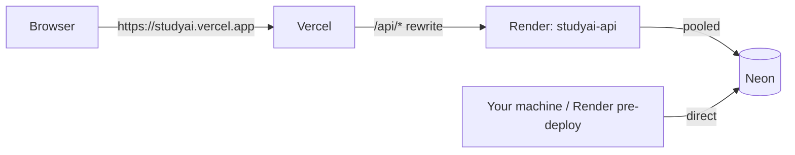

# Deployment guide

Target: **Neon** (PostgreSQL) → **Render** (API) → **Vercel** (SPA). Do the steps in order. Nothing here requires
committing secrets to Git.



## Credentials you need

| Service          | What to obtain                                      | Where it goes                                  |
| ---------------- | --------------------------------------------------- | ---------------------------------------------- |
| Neon             | Pooled connection string, direct connection string  | Render `DATABASE_URL`, `DATABASE_URL_UNPOOLED` |
| Google AI Studio | Gemini API key (https://aistudio.google.com/apikey) | Render `GEMINI_API_KEY` (optional)             |
| Render           | Account connected to your Git provider              | –                                              |
| Vercel           | Account connected to your Git provider              | –                                              |

## 1. Neon

1. Create a project (choose a region close to your Render region) and a database, e.g. `studyai`.
2. In **Connection details** copy both strings:
   - **Pooled** (host contains `-pooler`) → used by the running API.
   - **Direct** (no `-pooler`) → used for migrations.
     Both must include `?sslmode=require`.
3. From your machine, apply the schema and reference data:

   ```bash
   cd backend
   DATABASE_URL_UNPOOLED="<direct url>" DATABASE_URL="<direct url>" npm run db:migrate
   DATABASE_URL="<direct url>" npm run db:seed            # subjects only – never use --demo in production
   DATABASE_URL="<direct url>" ADMIN_EMAIL="you@college.edu" ADMIN_PASSWORD='<strong password>' ADMIN_NAME="Your Name" npm run create-admin
   ```

   (On Windows PowerShell set variables with `$env:DATABASE_URL="..."` first.)

## 2. Render (API)

1. Push the repository to GitHub/GitLab.
2. Render dashboard → **New → Blueprint** → select the repo. Render reads [`render.yaml`](../render.yaml).
3. Fill in the prompted secrets:
   - `DATABASE_URL` = Neon **pooled** string
   - `DATABASE_URL_UNPOOLED` = Neon **direct** string
   - `FRONTEND_URL` = your Vercel URL (you can set a placeholder now and update it after step 3)
   - `GEMINI_API_KEY` = optional
   - `ALLOWED_EMAIL_DOMAINS` = e.g. `college.edu` (or leave empty)
   - `JWT_SECRET` is generated automatically.
4. Deploy. Render builds with
   `npm ci --workspace=@studyai/backend … && npm run build --workspace=@studyai/backend` and starts
   `node backend/dist/server.js`, listening on Render's `PORT` (bound to `0.0.0.0`).
5. **Migrations on future deploys:** `preDeployCommand` runs `node backend/dist/db/migrate.js` on paid instance
   types. On the free plan, run `npm run db:migrate -w backend` from your machine (step 1.3) before deploying a schema
   change.
6. Verify: `https://<service>.onrender.com/api/health` → `{"status":"ok","database":"ok",…}`.

> Free Render instances sleep after inactivity; the first request can take ~30–60 s.

## 3. Vercel (frontend)

1. Edit [`frontend/vercel.json`](../frontend/vercel.json): replace `https://studyai-api.onrender.com` in the `/api`
   rewrite with your Render URL. Commit.
2. Vercel → **Add New Project** → import the repo → **Root Directory: `frontend`**. Framework preset: Vite.
   Vercel detects the npm workspace lockfile at the repository root. No environment variables are needed.
3. Deploy, then copy the production URL (e.g. `https://studyai.vercel.app`).
4. Back on Render, set `FRONTEND_URL` to that URL (comma-separate preview URLs if you want them to work) and redeploy.

## 4. Production verification checklist

Do not consider the deployment successful until each item is checked:

- [ ] `GET https://<vercel-url>/api/health` returns `status: ok` and `database: ok` (proves the rewrite + DB).
- [ ] Register a student with a college email; DevTools → Application → Cookies shows `__Host-studyai_session` with
      **HttpOnly** and **Secure**.
- [ ] Ask a question; it appears for a second student as “Anonymous student”; the Network tab response for
      `/api/questions/:id` contains no email or author id.
- [ ] Log in as the admin created in step 1.3 → provision a teacher and assign subjects; the teacher receives a
      notification when a student asks in that subject.
- [ ] If `GEMINI_API_KEY` is set: “Suggest subject” and “Explain with AI” work; `/api/health` shows `ai: configured`.
- [ ] Response headers on the SPA include `Content-Security-Policy` and `Strict-Transport-Security`.
- [ ] Ten rapid failed logins produce HTTP 429 _for you only_ (confirms `TRUST_PROXY=2` gives per-client limits).

## Troubleshooting

| Symptom                                            | Likely cause                                                                                                       |
| -------------------------------------------------- | ------------------------------------------------------------------------------------------------------------------ |
| Login works but you are immediately logged out     | `FRONTEND_URL`/rewrite mismatch, or calling Render directly instead of through `/api` (cookie becomes third-party) |
| `Invalid environment configuration` in Render logs | A required variable is missing – the message names it                                                              |
| Everyone gets 429 at once                          | `TRUST_PROXY` too low – should be `2` behind Vercel                                                                |
| `SSL connection required`                          | Connection string lacks `?sslmode=require`                                                                         |
| AI endpoints return 503 `AI_UNAVAILABLE`           | No `GEMINI_API_KEY`, invalid key, or model name not available to your key (`GEMINI_MODEL`)                         |
